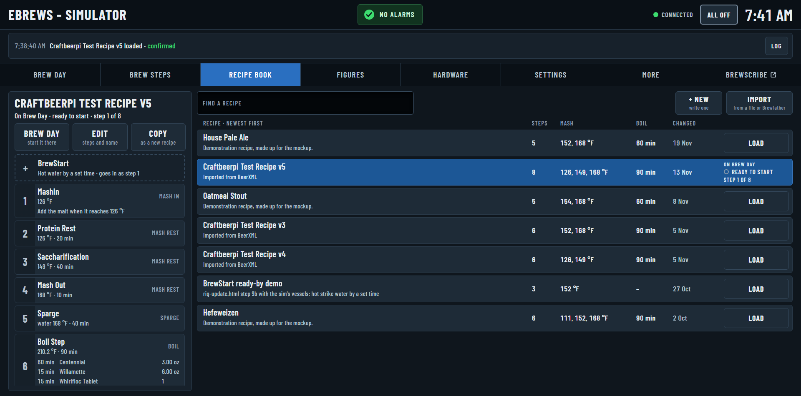
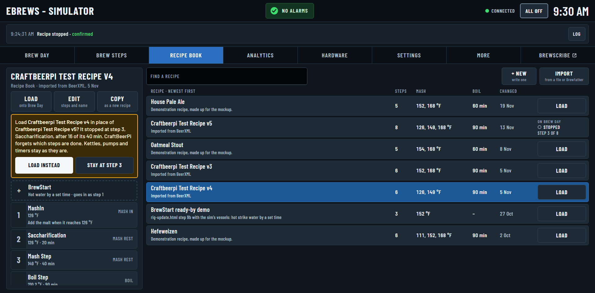
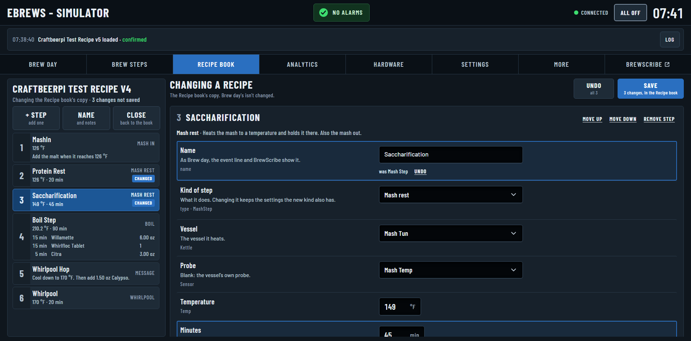
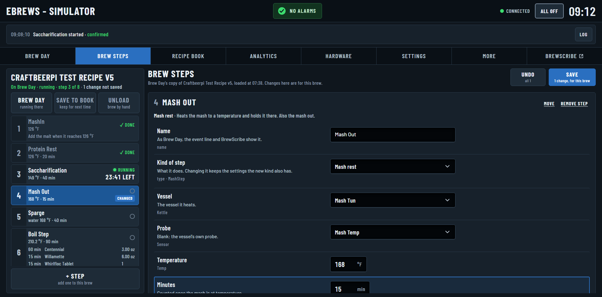

# Recipes: choosing one to brew, importing, and changing steps

A proposal for the Recipe book, a recipe's page, importing a recipe, and Brew steps, made the way Settings and Hardware were: Brew Day's title bar, tabs and look. Nothing is built yet. This is for you to approve or change.

**The mockup** is [`recipes.html`](recipes.html). Open it in a browser and use the links along the top to see each moment. Its recipes, vessels and settings are your simulator's (8012), read once and never written to. The recipes and files I made up say so on screen. Brew Day's part (OTHER RECIPE) is Amber's; she and I agreed how it works (below).

## What you asked (22 Nov)

> "Have the appropriate agent start working on refactoring the recipe import page, the steps editor (why is/was it called something similar to mash steps editor?) and refactor how I choose the recipe I want to brew."

## What's wrong today

Pictures of today's pages are in [`pictures/`](pictures/), named `today-…`.

- The Recipe book, the recipe editor, the import page and Brew steps are still the old green pages with the menu.
- **Choosing a recipe** means opening it, then pressing a paddle icon. Its only label is the hover tooltip "Send recipe to Kettle". A touch screen has no hover.
- **Brew Day** lists recipes with LOAD only when no recipe is loaded. On the rig a stale Test Recipe was loaded, so the list never appeared.
- **Importing also loads.** An import replaces Brew day's recipe at once. So does the paddle icon. If a step is running when either happens, CraftBeerPi stops it (its kettle's AUTO goes off) and loads the other recipe in its place.
- **Importing takes several steps.** You upload the file, and the page reloads. Then you pick the recipe from a drop-down and press "Create Recipe from BeerXML recipe".
- **Brew steps has its own START, NEXT, STOP and RESET** buttons, as unlabelled icons. Its START is one tap, so it gets round Brew Day's one-second held START.
- **SAVE on Brew steps** adds another copy to the Recipe book every time it's pressed, all with the same name.
- The editor's malt, hops, misc and yeast editors were never connected: no page uses them. A CraftBeerPi recipe has no ingredient list. The boil's additions live in its boil step.

## Your naming question

**Why was it called something like "mash steps editor"?** CraftBeerPi began with the mash. Its first versions ran a mash schedule: a list of rests, each a temperature held for a time. Brewing software calls that a mash profile; BeerSmith still does. So the page was "Mash Profile", and the code that lists and edits a recipe's steps was named `MashStepList` and `MashStepEditor`.

Later the steps grew to cover the whole brew day: mash in, the rests, mash out, the sparge, the boil and its additions, the whirlpool and cooling. The names stayed. On 5 Nov you said the name didn't fit ("it describes the entire brew day and not just mash"), so the menu now says Brew Steps. The page's address (`#/mashprofile`) and the code kept the old names so bookmarks would keep working.

**The words I propose:**

| Today | Proposed | Why |
|---|---|---|
| Brew Steps (menu); Mash Profile (address, code) | **Brew steps** | Unchanged: the steps of the recipe on Brew day. |
| A recipe's "Brew Steps" | **Steps** | A recipe in the book has steps. Brew steps are the copy Brew day runs. Two names, because they are two copies. |
| Paddle icon, "Send recipe to Kettle" | **LOAD**, "onto Brew day" | Brew Day's own word, on a button that says what it does. |
| Import recipe, Upload, "Create Recipe from BeerXML recipe" | **IMPORT** | One word for one act. |
| Clone | **COPY** | |
| Clear (Brew steps) | **UNLOAD**, "brew by hand" | It undoes LOAD. |
| Save (Brew steps to the book) | **SAVE TO BOOK** | It asks: replace the copy they came from, or save as a new recipe. |
| Basic Data | **Name and notes** | |
| MashInStep, MashStep, SpargeStep, BoilStep, NotificationStep, WhirlpoolStep, CooldownStep, WaitStep, ToggleStep, ActorStep, BrewStart | **Mash in, Mash rest, Sparge, Boil, Message, Whirlpool, Cool down, Wait, Switch on or off, Run a switch, BrewStart** | CraftBeerPi's own name stays under each in small type, as on Settings and Hardware. |

In the code, Brett could rename `mashprofile` to `brewsteps`, and `MashStepList` to `StepList` (one list for both pages), and delete `MashStepEditor` and the four ingredient editors. The addresses could become `#/brewsteps`, with `#/mashprofile` still working. That part is his call; you'd only see it in the address bar.

## How it works

### A recipe looks the way Brew Day will show it

On a monitor, the open recipe sits on the left, **in the place and shape of Brew Day's recipe column**: its name, a line saying where it is, three buttons, then its steps, numbered, with temperatures, minutes and the boil's additions, exactly as Brew Day lists them. What you choose is what Brew Day will show, in the same spot. Where nothing runs, the right side of each step says what kind of step it is (MASH REST, SPARGE, BOIL).

The right side holds the book, a recipe's settings, or importing.

### The Recipe book

- **One row per recipe, newest first** (the one just imported or changed is usually the next one brewed), with FIND A RECIPE above. FIND looks in names, where a recipe came from, step names and boil additions, so "citra" finds every recipe with Citra.
- **The numbers that tell recipes apart sit in fixed columns**: steps, mash temperatures, boil minutes and when it last changed. So v3, v4 and v5 line up, and their differences show by eye.
- **Each row ends in LOAD.** The recipe on Brew day has no LOAD. Its row says what it is doing instead, in Brew Day's own words: READY TO START · STEP 1 OF 8, RUNNING · STEP 3 OF 8 (with a green lamp), STOPPED · STEP 3 OF 8, or FINISHED.
- **Tap a row** to open the recipe on the left. **+ NEW** writes one. **IMPORT** brings one in.

### Choosing the recipe to brew: LOAD

LOAD has the same rules everywhere: on a book row, at the top of an open recipe, and in Brew Day's own list.

1. **One tap** when nothing is loaded, or the loaded recipe hasn't begun or has finished. The recipe it replaces stays in the Recipe book. The button says LOADING… while CraftBeerPi answers, the row then says READY TO START, and the event line says "Craftbeerpi Test Recipe v4 loaded · confirmed".
2. **It asks first** once a brew has begun but no step is running (stopped, failed, or the boil waiting for you), because CraftBeerPi then forgets how far the brew got. It asks in place, as Brew Day's RESET does: "Load Craftbeerpi Test Recipe v4 in place of Craftbeerpi Test Recipe v5? It stopped at step 3, Saccharification, after 16 of its 40 min. CraftBeerPi forgets which steps are done. Kettles, pumps and timers stay as they are." The answers are LOAD INSTEAD and STAY AT STEP 3, and neither is the default.
3. **Greyed while a step runs**, and tapped, it says why, in brewing words: "Craftbeerpi Test Recipe v5 is running: Saccharification, 23:41 left. Stop it on Brew day first." Overnight, a BrewStart waiting for its time counts as running: "BrewStart is waiting to have the HLT at 152 °F by 18:35."

**On Brew Day** (Amber's part, agreed): while a recipe is loaded and not begun, its column offers **OTHER RECIPE**. That opens the five newest recipes, in the same rows, with LOAD, then ALL RECIPES (this page) and CLOSE. Once you LOAD one, the column becomes that recipe, ready to start. After a brew finishes, Brew Day goes back to "No recipe running", with every recipe and LOAD. Mid-brew, Brew Day offers no swap; that is the Recipe book's question above.

### Importing

IMPORT opens on the right, in three parts:

- **From a file:** drop the file, or CHOOSE FILE. That's a BeerXML file from BeerSmith or most brewing programs, an MMuM file, or a Kleiner Brauhelfer database. Its recipes are listed straight away, with no page reload, each with IMPORT. The last file sent stays listed, so after changing a setting you can import again without sending it again. A line says how to export from BeerSmith.
- **From Brewfather:** if your Brewfather user ID and API key are in Settings, your Brewfather recipes are listed A to Z, with FIND and REFRESH LIST. Today's "50 at a time" page picker goes. If they aren't set, a line says where to set them.
- **Imports use these settings:** the mash tun, the boil kettle, the boil and whirlpool temperatures, the sparge step, and whether mash in and mash out are added. These are the things a recipe file can't say. The whirlpool temperature matters most, because a BeerXML file never gives one.

**IMPORT only adds the recipe to the Recipe book. It no longer changes Brew day.** So an import can never replace a brew. The result shows in place: "Imported Craftbeerpi Test Recipe v6. It's in your Recipe book, at the top." The new recipe opens on the left so you can check its steps, and its row is there with LOAD (Amber's suggestion), so going from import to brewing costs one tap more than today.

Importing a recipe again under the same name replaces the earlier import, never a recipe you've changed or saved here, as since 5 Nov. CraftBeerPi's warnings show in place too, as well as in the title bar. For example: "This recipe has 7 boil additions, but the boil step can remind you of only six." A refusal says why in CraftBeerPi's words, with SETTINGS beside it.

### Changing a recipe (the steps editor)

EDIT, or a tap on any step, opens the recipe's settings on the right. The steps on the left become its index, as Settings' groups are: tap one to jump to it, and the one in view is marked in blue.

- **Two copies, said plainly.** The Recipe book keeps recipes. LOAD copies one onto Brew day. Changing a recipe in the book changes the book's copy, and the page says so at the top ("The Recipe book's copy. Brew day's isn't changed."). Brew steps changes Brew day's copy.
- **One SAVE, with UNDO, as on Settings and Hardware.** A changed setting turns blue and says what it was, with its own UNDO. The step on the left is tagged CHANGED, NEW, MOVED or REMOVED. SAVE says how many changes it will save. Leaving with changes asks: SAVE AND GO, GO WITHOUT SAVING, or STAY.
- **Each setting in plain words**, with one line on what it does and CraftBeerPi's name underneath. For example, "Minutes · Counted once the mash is at temperature · Timer", or "Switch AUTO on · No: nothing heats for it, and you run the vessel by hand · AutoMode". Settings come in groups, such as a mash in's "When the water is ready".
- **The boil's additions** are one line each: minutes left and what to add, with REMOVE. + ADDITION stops at six, because the boil step has six reminders, and says so.
- **+ STEP** lists the kinds of step in brewing order (Mash, Sparge, Boil, After the boil, Any time), each with what it does, and asks where to put it. A new step starts with CraftBeerPi's own defaults for its kind (AUTO on, its vessel chosen), so it heats as it should. MOVE UP, MOVE DOWN and REMOVE STEP sit on each step.
- **Delete** is last, apart from everything else, and asks first: "Delete Craftbeerpi Test Recipe v3 from the Recipe book? This can't be undone."
- **Saved while it's on Brew day.** If you change the recipe that's loaded and not begun, the page says Brew day still has the older copy, with **LOAD AGAIN**. Once a brew has begun, it says the change is for next time.

### Brew steps

The same page shape, for **Brew day's copy**: the loaded recipe on the left as Brew Day shows it, with ✓ DONE and a running step's time left, and its settings on the right.

- Changes here are for this brew, with SAVE and UNDO. **SAVE TO BOOK** keeps them for next time. It asks whether to **replace the book's copy** it was loaded from, or **save as a new recipe** under a name you give.
- A running step's settings are greyed, with the reason: CraftBeerPi doesn't change a step while it runs. A finished step says a change counts only after a reset to step 1.
- **UNLOAD** follows LOAD's rules, and Brew day goes back to brewing by hand.
- **No START, NEXT, STOP or RESET here any more.** They're on Brew Day, where START is held for a second. BREW DAY takes you there.

### On a laptop, a tablet and a phone

- **A laptop (1366 wide) or larger:** one screen. The steps and the right-hand side scroll on their own.
- **900 to 1179 px:** still side by side. The page scrolls and the recipe stays in view beside it.
- **899 px and narrower:** one thing at a time. First the book, then a recipe, then one step's settings, each with the way back at its top.
- **A phone** does everything a monitor does, with SAVE on a bar above the tabs.

Pictures: [`13-book-laptop`](pictures/13-book-laptop.png), [`14-edit-tablet`](pictures/14-edit-tablet.png), [`15-book-phone`](pictures/15-book-phone.png), [`16-recipe-phone`](pictures/16-recipe-phone.png), [`17-ask-phone`](pictures/17-ask-phone.png), [`18-step-phone`](pictures/18-step-phone.png).

## Agreed with Amber (Brew Day's designer)

1. One word, LOAD, and one row look on both screens: Brew Day's own recipe-book row.
2. The loaded recipe's row uses Brew Day's status words in capitals, plus FINISHED.
3. Brew Day offers another recipe (OTHER RECIPE) only where LOAD is one tap: a recipe loaded and not begun. Where it goes in her column waits on the column rework you asked her for tonight.
4. After LOAD on Brew Day, the column becomes the new recipe. A refusal shows its reason under the list.
5. Import only adds to the book, and its page ends on the new recipe's row, with LOAD.
6. A greyed LOAD names what is running, in brewing words.
7. A known limit, with no question for it: LOAD on a recipe not begun drops changes made to its brew steps since loading. Examples are BrewStart's ready-by time, the water and grain temperature, and a strike temperature from the strike water's USE. Pressing START protects them, because BrewStart then counts as running. A question every time would become a habit.

## Assumptions I made

1. You import mostly BeerXML from BeerSmith. MMuM, Kleiner Brauhelfer and Brewfather stay, below it.
2. You change recipes mostly at the desk, on the monitor. A phone can still do all of it.
3. The book stays small, tens of recipes, so newest first with FIND is enough. No folders or tags.
4. The malt, hops, misc and yeast editors aren't wanted: CraftBeerPi's recipes have no ingredient list, and BeerSmith keeps yours.
5. Changes are saved with one SAVE, as on Settings and Hardware, both in the book and on Brew steps.
6. The plain names for the kinds of step, above, are close enough to the words you use.

## Questions for you

1. **The layout:** is the recipe on the left, as Brew Day shows it, with the book and its settings on the right, how you want to see a recipe while choosing and changing it? The design tool dealt two other layouts. One arranges the steps by vessel under the brewhouse drawing. The other is a brew sheet: one table of steps, changed in place. All three show the same recipe, side by side, in [`24-compare-layouts-phone`](pictures/24-compare-layouts-phone.png) and [`25-compare-layouts-monitor`](pictures/25-compare-layouts-monitor.png).
2. **Import no longer loads.** After importing you press LOAD, one tap more than today, and an import can never replace a brew. All right?
3. **Brew steps loses START, NEXT, STOP and RESET.** They stay on Brew Day, where START is held. Do you use the ones on Brew steps today?
4. **The names:** Mash rest for MashStep, Message for NotificationStep, Run a switch for ActorStep, and the rest in the table. Any you'd call something else?

## What CraftBeerPi (the server) would need

"Web page" means only the web page changes, with no CraftBeerPi update.

| Change | Why |
|---|---|
| **1. Import without loading.** The import endpoints (`POST /upload/xml` and the rest) keep the recipe in the book and leave the brew steps alone, and answer with the book file's id, whether it replaced an earlier import, and the import's warnings. A refusal ends "Nothing was added to the Recipe book" instead of "The brew steps are unchanged". | An import can't replace a brew, and the page can show the result and the warnings in place and open the new recipe. Today `import_recipe` calls `load_recipe`, which stops a running step first. |
| **2. `POST /recipe/{id}/brew` refuses with 409 while a step runs** ("A step is running. Stop it before loading another recipe."), as `/step2/reset` already does. | The page greys LOAD then, but an older page or another screen could still send it, and today CraftBeerPi would stop the running step and load the other recipe. |
| **3. `POST /step2/clear` refuses the same way.** | UNLOAD, for the same reason. |
| **4. Loading records which book recipe it came from, and when**: `book_file` and `loaded_at` in the brew steps' basic data, left out of `book_data()`. | The book can mark exactly which recipe is on Brew day (two recipes can share a name). Brew steps can say where its copy came from. SAVE TO BOOK can replace that copy, and LOAD AGAIN appears only when the book's copy is newer. Without it the page goes by the name, which works until two recipes share one. |

Everything else is web page only. That covers the pages themselves, FIND, the plain names, SAVE and UNDO, saving Brew steps step by step, sending a file without a reload, finding in the Brewfather list (CraftBeerPi already sends the whole list), and SAVE TO BOOK as a new recipe with its own name (`/recipe/create`, then a save).

Brett is making changes 2 and 3 now, in CraftBeerPi 4.7.7.post51, because today they can end a running rest with one tap. Until you answer question 2, an import is refused while a step runs too. Changes 1 and 4 wait for your answers.

## For Brett, when it's approved

- The mockup is built like Settings' and Hardware's. The frame rules at the top of `recipes.css` are Settings' copy of Brew Day's, so a port script like `design/settings/port.mjs` can leave them out. `recipes-catalog.js` is the plain-name catalogue, as `catalog.js` is for Settings, and `recipes-data.js` is the demo data.
- LOAD's rules are `loadRule()` and `runningWhy()` in `recipes.js`, and they match Amber's list. The step lines (`stepView`, `additions`, `bookLine`) follow `stepModel`, `additions` and `bookLine` in `brewday/live.js`, so both pages say the same.
- The mockup answers every command after a second. The moments in the strip are its test cases.

## The other two layouts the tool dealt

The design tool picks among my own list of layouts at random, so I don't always land on the obvious one. For this page it dealt three. The lead is the one above. The other two are drawn with the same recipe open, Craftbeerpi Test Recipe v5, on a monitor and a phone. Each is one picture, not a clickable page.

- **Steps by vessel, on the drawing** ([monitor](pictures/20-other-layout-by-vessel-monitor.png), [phone](pictures/21-other-layout-by-vessel-phone.png)): Brew Day's line drawing across the top, and each step listed under the vessel it runs on, numbered in the order it runs. The sparge water is at the HLT; mash in, the rests and mash out are at the mash tun; the boil and whirlpool are at the boil kettle. The book is a list down the left. It's good for seeing which vessel does what. It's poorer for order, which matters more in a recipe: the numbers jump between columns (5 at the HLT, 1 to 4 at the mash tun). On a phone there is no drawing, as on Brew Day, so the vessels are stacked, with the HLT first.
- **A brew sheet** ([monitor](pictures/22-other-layout-brew-sheet-monitor.png), [phone](pictures/23-other-layout-brew-sheet-phone.png)): the recipe's numbers across the top in small windows (steps, mash, boil, additions, whirlpool), then one ruled table: step, kind, vessel, temperature, minutes, and what it says or the boil's additions. Each cell would change in place, with one SAVE. It's the most compact on a monitor, and the easiest to check against BeerSmith's brew sheet. It's cramped on a phone, where each row becomes a block, and the plain-word help for each setting has nowhere to go.

[`19-v5-open-phone`](pictures/19-v5-open-phone.png) is the proposed design on a phone with the same recipe open, so the three can be compared.

## What I read for this

Your standing sources, for these decisions:

- **NN/g's heuristics:** show what the system is doing (the loaded recipe's state on every row); use the user's words (LOAD, not a paddle); prevent errors (import can't replace a brew); recognition rather than recall (the import settings shown where you import, not remembered from Settings).
- **NN/g, recognition and recall:** for the same reason.
- **MIT 6.831 lecture 5, errors:** errors that destroy work are the worst kind, so confirmations are kept for acts that are hard to undo (LOAD over a begun brew, delete, replacing the book's copy). Dangerous commands sit apart from frequent ones (delete at the end), and rows of look-alike buttons are avoided.
- **Norman:** one conceptual model that matches the world: a recipe book, and the copy on today's brew day.
- **id-book:** the recipe-book metaphor.
- **GT CS 6750:** closing the gulfs of execution and evaluation: LOAD answers at its button, and the row then shows the result.
- **W3C WAI form grouping:** each step's settings grouped under headings, visibly and in the code.

## Files

| File | What |
|---|---|
| `recipes.html` | The mockup, with a link to each moment along the top. Add `?bare` to hide the strip. |
| `recipes.css`, `recipes.js` | Its look and behaviour. |
| `recipes-data.js` | The simulator's recipes, vessels and import settings, and the made-up ones. |
| `recipes-catalog.js` | The plain names of each kind of step and its settings. |
| `other-layouts.html`, `.css`, `.js` | The two other layouts, drawn for their pictures: `?layout=vessel` and `?layout=sheet`. `rig.js` is Brew Day's drawing, copied from `design/brewday`. |
| `pictures/` | The moments at monitor, laptop, tablet and phone sizes, the three layouts side by side (`24-…`, `25-…`), and today's pages (`today-…`). |
